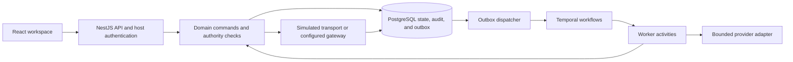

# Intent architecture

Intent uses a modular monolith with a separately running Temporal worker. PostgreSQL owns business state, authorization, audit history, and the durable outbox. Temporal owns workflow execution and recovery. Modules are code boundaries, not separate network services.

## Packages

| Unit | Responsibility |
| --- | --- |
| `apps/web` | Evidence inspection, human decisions, forms, navigation, and translations |
| `apps/api` | Authentication, strict request validation, HTTP errors, same-origin static serving |
| `packages/contracts` | Validated shared input and output shapes |
| `packages/database` | PostgreSQL/Drizzle schema, migrations, and explicit fictional fixtures |
| `packages/domain` | Tenant/resource permissions, transactions, revisions, approvals, and effect ledger |
| `packages/harness` | Bounded inference, grounded model output, and registered capabilities |
| `apps/worker` | Temporal workflows, activities, durable outbox publication, and heartbeat |

`IdentityService` owns credentials, sessions, and login limits. `ProductService` owns customer edits, fact review, private conversations, failed-run successors, and the work inbox. `IntentService` governs planning, approvals, and execution. `CommercialService` owns opportunity and financial business records.

## Evidence to outcome

Importing evidence commits the source, planning request, and outbox entry in one transaction. The dispatcher starts a stable workflow identity. An activity reads the initiating member's currently authorized context and asks the configured provider for grounded candidates and a draft.

Plan acceptance verifies source IDs, exact quotes, and recipient authority before recording the result. Candidate facts need human review. Approval binds the exact proposal revision and current access and delivery versions. A signal wakes the workflow; a domain check still determines whether execution is allowed.

The worker persists a dispatch claim before contacting a configured gateway. A positive confirmation records delivery; ambiguous responses become unknown and block automatic redispatch. Customer replies can return as authenticated, deduplicated evidence. A receipt never implies consent, a contract, or payment.

## Trust and consistency

The host determines tenant and actor. Every command resolves current active membership and authority version, and checks customer ownership where required. Composite foreign keys prevent cross-tenant relationships. Audit events and business changes share a transaction.

Password sessions are hashed in storage and revoked when relevant account authority changes. Production requires a configured HTTPS origin and rejects development authentication. Conversations remain private to their member and lose accessibility when customer access is revoked.

Outbox publication is acknowledged only after Temporal accepts it. Stable workflow IDs and operation identities make retries safe. Failed planning creates an explicit successor while preserving history. Unknown external delivery uses reconciliation rather than retry. Customer-scope locks precede dependent records; financial commands lock contracts before installments.

## Providers and credentials

Fixture is deterministic and makes no external inference requests. DeepSeek and custom OpenAI-compatible Chat Completions are configurable providers. Live providers must pass a configuration test before activation. Their responses cannot grant authority or directly mutate business records.

Credentials use authenticated encryption with a deployment-provided key. Public views exclude plaintext and ciphertext. Provider requests use approved public HTTPS hosts, DNS validation and pinning, disabled redirects, and bounded time, size, and context. Shared API admission bounds concurrent and recent requests; it is not a token budget or a guarantee of exactly-once provider billing.

## Deployment

The application image runs separate API and worker processes. The API serves the built web application on the same origin. Migrations and initial administrator creation are explicit one-shot operations. PostgreSQL uses an explicitly provisioned persistent volume; production Temporal must also be persistent and protected.

Local development uses Compose PostgreSQL and the Temporal CLI development server. These defaults, Fixture models, and simulated delivery are for disposable development. Production operators validate provider/gateway behavior, HTTPS, backups and restoration, network controls, and capacity for their workload. See the [deployment guide](../docs/deployment.md) and [upgrade guide](../docs/upgrade.md).

The commercial overview currently aggregates a tenant's records in application memory. Organizational hierarchy, SSO/MFA, bank synchronization, and accounting revenue recognition are outside the implemented scope. Load capacity and live integration correctness require their own evidence.

## Further reading

- [Shared application contracts](contracts.md)
- [Commercial and management contracts](management-contract.md)
- [Production integration and lifecycle contract](production-contract.md)
- [Development and verification](development.md)
